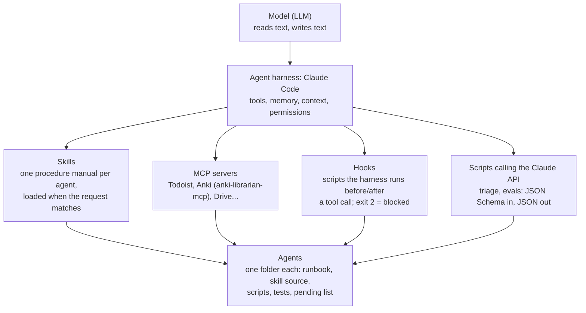
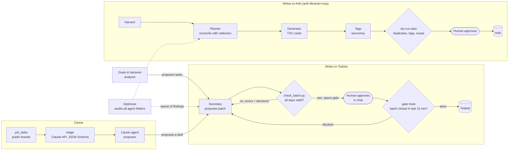

# personal-ai-agents

A personal system of AI agents that I designed and run daily with Claude Code: a scheduling secretary, a
flashcard librarian with a multi-stage card pipeline, a habits data pipeline, a career researcher, a goals &
behavior analysis agent with a memoir scribe, and a meta-agent that audits the others. The point is the
**engineering around the model**: deterministic hooks that block unsafe writes, validators that must pass
before anything touches live data, human approval for every write, regression tests built from real past
errors, automated evals, and privacy filters before anything is published.

> The full system lives in a private local repository (600+ commits). This repository is an **excerpt**: some
> files are copied almost verbatim, others are simplified re-implementations of larger production modules (each
> file's docstring says which). All examples and fixtures are fictitious.

## What runs here

| Piece | What it does | Run it |
|---|---|---|
| Todoist gate | a hook refuses every write to the task manager unless a validated batch was closed in the last 15 minutes | `python src/todoist_gate/check_batch.py examples/batch_blocked.json` |
| Claude API client | structured output (JSON Schema), retries with backoff, timeout, call cap, response cache, demo mode, JSON log | used by the two below |
| Job triage | job-board delta -> one structured verdict per new opening (apply / monitor / discard) | `python src/career/triage.py <out_dir>` |
| Automated evals | the career skill's request cases run on their own, graded by a separate LLM judge, with negative controls | `python src/agent_evals/run_evals.py --demo` |
| Optimizer queue | findings generated by checks; a fixed finding closes by itself | `python src/optimizer/queue.py examples/sample_system --dry` |
| Privacy filter | allowlist + denylist audit before anything personal is published | `python src/privacy/public_filter.py page.html` |

The flashcard side has its own repository, **anki-librarian-mcp** (see [Related repositories](#related-repositories)).

## Architecture

### Layers



Folder is the source of truth: each agent is a folder with a `CLAUDE.md` runbook, its skill source, `src/`,
`tests/` and a single pending list. The installed skill is only a pointer to that folder.

### How agents hand work to each other



## The agents

| Agent | Purpose | Tools / APIs | Main guardrail | Tests |
|---|---|---|---|---|
| [Secretary](docs/secretary-todoist.md) | Plan and replan day/week in Todoist | Todoist MCP, Python validator | Hook blocks writes without a validated batch; no recurrence-killing edits; no deletes without explicit request | 73 backtest cases + 412 scripted checks (prod, all passing on 18 Oct 2026); hook + golden batches (here) |
| [Librarian + card pipeline](docs/librarian-anki.md) | Govern the flashcard collection; harvest -> plan -> generate -> tag | AnkiConnect via [anki-librarian-mcp](#related-repositories) | Write lock with allowlist; scheduling and deletion forbidden; dry-run plan + human approval | fake-AnkiConnect tests (prod and in the MCP repo) |
| [Habits](docs/habits-pipeline.md) | Phone-app export -> spreadsheet -> KPI dashboard | SQLite export, openpyxl, HTML | Writes only with ok; public version through allowlist + denylist audit | A/B snapshot test (prod); privacy filter (here) |
| [Career](docs/career.md) | Triage opportunities, research, CV, interview prep | Public job boards, **Claude API** | Never opens login-walled sites; never sends or applies on my behalf; business rules checked on every model answer | 12 request cases as automated evals (11/12) + delta and triage tests (here) |
| [Optimizer](docs/optimizer.md) | Audit and standardize the other agents | git, Python checks | Acts alone only on what a check proves; asks before structural changes | reconciliation tests (prod and here) |
| [Goals & behavior analysis](docs/goals-behavior-analysis.md) | Read the data against the goals; run the quarterly goals ritual | task manager (read), habits bulletin | Writes goals only after approval of the exact text; never writes another agent's system | request cases (prod) |
| [Memoir scribe](docs/memoir-scribe.md) | Interview -> memoir entry in the author's style | Markdown files in git | Provenance label on every entry; AI analysis never enters the memoir | - |

## Calling the model API

Everything above runs inside Claude Code, but two pieces call the Claude API directly from Python, through one
small client (`src/llm/client.py`):

| Concern | How |
|---|---|
| Structured output | the request carries a JSON Schema (`schemas/`); the answer is validated again with `jsonschema` |
| Business rules | an optional `check` in code; a failing answer is sent back once with the complaints, then the run stops for that item |
| Retries / timeout | exponential backoff with jitter on 429, 5xx and connection errors; 30 s per attempt |
| Cost | cheapest model (Claude Haiku 5.5), `max_tokens` 600, effort `low`, a hard call cap per run |
| Cache | every accepted answer is recorded (`recordings/`); an identical request is never paid twice |
| Demo mode | without a key the recordings replay the run: tests and CI need no secret |
| Observability | one JSON line per call in `logs/` (task, request hash, source, tokens, latency, problems) |
| Secrets | `ANTHROPIC_API_KEY` from the environment or `.env` (git-ignored); never printed or logged |

Measured on 19 Oct 2026: the triage of 35 real openings made 20 calls for US$ 0.003; an eval run (12 cases +
2 controls) about US$ 0.007. Both are free to repeat.

## Automation (GitHub Actions)

- **tests** (every push): the unit tests, then the eval regression gate on the recorded answers (fails if fewer
  than 11 of 12 cases pass or if the judge passes a negative control).
- **weekly job triage** (Mondays, and on demand): job-board delta + LLM triage, at most 15 calls, state kept
  between runs with the Actions cache, report uploaded as an artifact. It runs only if the `ANTHROPIC_API_KEY`
  secret exists; without it the job does nothing.

## Design principles

1. **The folder is the source of truth.** Runbook, skill, scripts and tests live together in git; anything
   installed elsewhere is a cache or a pointer.
2. **Validate before write.** A deterministic script checks the whole proposal; the write tool is physically
   blocked by a hook until the check passes. The model's confidence is not evidence.
3. **Code first, model for the fuzzy part.** What a rule can decide is decided in code (the triage discards
   senior roles with no call); the model only reads free text, and its answer is checked against the rules.
4. **Human approval for live data.** Agents read freely; every write to Todoist, Anki or a spreadsheet goes
   through an explicit "ok". Approval flags expire after 15 minutes.
5. **Every mistake becomes a check.** A new error class gets a rule in the validator and a regression case.
6. **Generator != evaluator.** The eval judge never sees the skill it is grading; negative controls keep it honest.
7. **One commit per batch**, staging only the touched paths; pushes are denied in the harness settings.
8. **Privacy by default.** Allowlist what is shown, audit what is rendered, abort on any hit.
9. **Secrets out of code.** OAuth connectors for SaaS tools; API keys from the environment (`.env.example`).

## What maps to the job

| Requirement | Where it shows up here |
|---|---|
| Multi-step agents (planner / researcher / analyst / reviewer) | Card pipeline harvest -> planner -> generator -> tags; Secretary propose -> validate -> write; eval agent -> judge |
| LLM beyond chat (API, structured output, pipeline) | `src/llm/client.py`, `src/career/triage.py`, `src/agent_evals/run_evals.py` |
| Tool use with schemas and validation | `schemas/*.json` + `jsonschema`; `check_batch.py` gating MCP calls |
| Guardrails and policies | `gate_hook.py`, triage business rules, blocked sources in `job_delta.py`, the Anki write lock |
| Evals / golden sets | request cases + LLM judge + negative controls + scoreboard; golden batches; snapshot tests |
| Logging / traceability | JSON log per call; generated delta and triage reports; queue with "since" dates |
| Retries, timeouts, idempotency | client backoff and timeout; delta state and per-opening verdicts (second run = 0 calls) |
| Git with README and runbook | this repo; `RUNBOOK.md`; each agent's `CLAUDE.md` is its runbook |
| Secrets out of code | `.env.example`, Actions secret, OAuth connector, `.gitignore` |
| LGPD / privacy | `public_filter.py`, fictitious examples, private agents documented by architecture only |

## Run it

Python 3.10+. The Todoist gate, the queue and the privacy filter use the standard library only; the API pieces
need `pip install -r requirements.txt`.

```
python -m unittest discover -s tests                     # 54 tests, no network, no API key, no Anki, no Todoist
python src/agent_evals/run_evals.py --demo               # replays the recorded eval run: 11/12, 0 calls
python src/career/job_delta.py config/sources.csv out/   # public boards -> delta
python src/career/triage.py out/ --max 10                # needs ANTHROPIC_API_KEY (or --demo)
```

See [RUNBOOK.md](RUNBOOK.md) for setup and troubleshooting.

## Related repositories

- [anki-librarian-mcp](https://github.com/gcabralcavalcanti/anki-librarian-mcp): the MCP server that connects a
  model to Anki with the Librarian's write lock, dry-run plans, human approval and an audit log.

## License

MIT - Guilherme Cabral.
