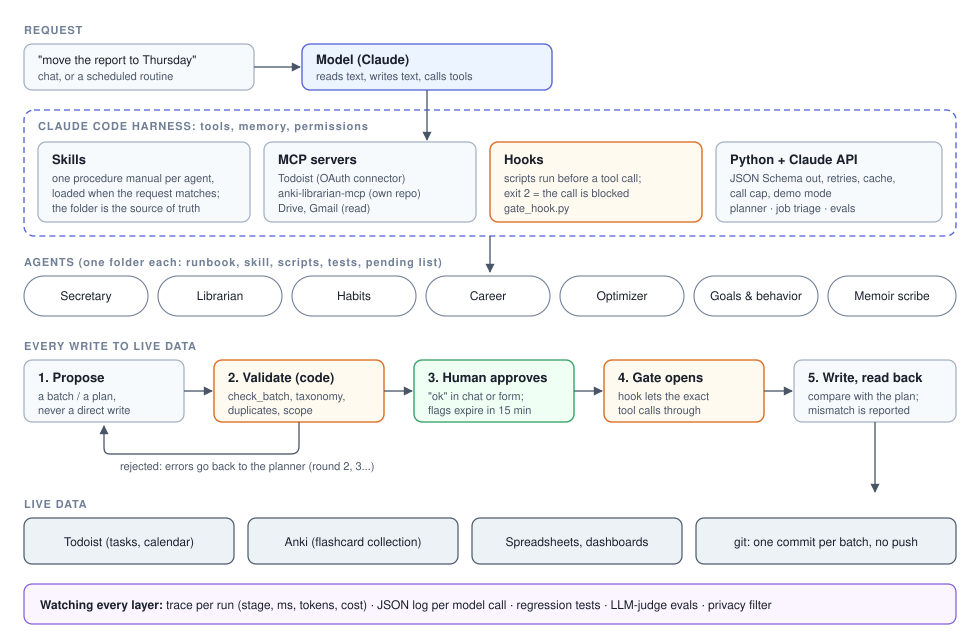

# personal-ai-agents

Seven AI agents I run every day in Claude Code, and the engineering that keeps them safe: hooks that block
unsafe writes, validators that must pass first, human approval, regression tests and evals.


## Results

| Result | Source in this repo |
|---|---|
| One request, end to end: round 1 blocked by the validator, round 2 closed, then approval and write; 2 model calls, US$ 0.0013 when recorded, free to replay | `python demo.py` · [`examples/demo_trace.jsonl`](examples/demo_trace.jsonl) |
| Automated evals of the career skill: **11/12** cases pass, the judge fails **2/2** negative controls | [`evals/scoreboard.csv`](evals/scoreboard.csv) · [`evals/last-run.md`](evals/last-run.md) |
| Job triage on real public boards: 35 openings, 16 decided by code with no call, 19 by the model, US$ 0.003 | [`examples/triage_report.md`](examples/triage_report.md) |
| 63 tests, no network, no API key, no Todoist, no Anki | [`tests/`](tests/) |



## Run it

```
pip install -r requirements.txt
python demo.py
```

No API key needed: the model's answers were recorded on a live run and replay. On a fictitious task board, the
request "move the weekly report to Thursday morning, run the regression tomorrow afternoon" goes through the
whole guarded path:

```
1. The model tries to reschedule right away   -> hook exit 2: BLOCKED (gate)
2. Planner (Claude API), round 1, sees only the requested day
   Validator: PAST_DIRTY, LOST_TASK x4 ...       -> BATCH OPEN - do not write
3. Planner, round 2, gets the whole board and the validator's report
   Validator                                      -> BATCH CLOSED - safe to write
4. Human approves; the same hook now lets reschedule-tasks and add-tasks through; a fake Todoist applies them
5. Trace: 8 stages with status, ms, tokens and cost  (examples/demo_trace.html)
```

Full output: [`examples/demo_output.txt`](examples/demo_output.txt). Other entry points:

| Piece | What it does | Run it |
|---|---|---|
| End-to-end demo | request -> planner (Claude API) -> validator -> gate hook -> approval -> write -> trace | `python demo.py` |
| Todoist gate | a hook refuses every write to the task manager unless a validated batch was closed in the last 15 minutes | `python src/todoist_gate/check_batch.py examples/batch_blocked.json` |
| Claude API client | structured output (JSON Schema), retries with backoff, timeout, call cap, response cache, demo mode, JSON log | used by the planner, the triage and the evals |
| Trace viewer | one `trace.jsonl` per run (stage, status, duration, calls, tokens, cost); terminal table or static HTML | `python src/tracing/view.py --last [--html trace.html]` |
| Job triage | job-board delta -> one structured verdict per new opening (apply / monitor / discard) | `python src/career/triage.py <out_dir>` |
| Automated evals | the career skill's request cases run on their own, graded by a separate LLM judge, with negative controls | `python src/agent_evals/run_evals.py --demo` |
| Optimizer queue | findings generated by checks; a fixed finding closes by itself | `python src/optimizer/queue.py examples/sample_system --dry` |
| Privacy filter | allowlist + denylist audit before anything personal is published | `python src/privacy/public_filter.py page.html` |

Setup and troubleshooting: [`RUNBOOK.md`](RUNBOOK.md).

## How it works

1. A request reaches the model inside Claude Code; the matching agent's skill (its procedure manual) loads.
2. The agent reads freely: Todoist and Anki through MCP servers, files, public web pages.
3. Every write is proposed as a batch or plan, never sent directly.
4. Code validates the whole proposal (`check_batch.py`, taxonomy, duplicates); errors go back to the planner.
5. The human approves; a PreToolUse hook lets only the validated calls through; the result is read back.
6. Traces, JSON logs, regression tests and evals watch every layer.

| Agent | Purpose | Tools / APIs | Main guardrail | Tests |
|---|---|---|---|---|
| [Secretary](docs/secretary-todoist.md) | Plan and replan day/week in Todoist | Todoist MCP, Python validator | Hook blocks writes without a validated batch; no recurrence-killing edits; no deletes without explicit request | 73 backtest cases + 412 scripted checks (prod, all passing on 18 Oct 2026); hook + golden batches (here) |
| [Librarian + card pipeline](docs/librarian-anki.md) | Govern the flashcard collection; harvest -> plan -> generate -> tag | AnkiConnect via [anki-librarian-mcp](https://github.com/gcabralcavalcanti/anki-librarian-mcp) | Write lock with allowlist; scheduling and deletion forbidden; dry-run plan + human approval | fake-AnkiConnect tests (prod and in the MCP repo) |
| [Habits](docs/habits-pipeline.md) | Phone-app export -> spreadsheet -> KPI dashboard | SQLite export, openpyxl, HTML | Writes only with ok; public version through allowlist + denylist audit | A/B snapshot test (prod); privacy filter (here) |
| [Career](docs/career.md) | Triage opportunities, research, CV, interview prep | Public job boards, **Claude API** | Never opens login-walled sites; never sends or applies on my behalf; business rules checked on every model answer | 12 request cases as automated evals (11/12) + delta and triage tests (here) |
| [Optimizer](docs/optimizer.md) | Audit and standardize the other agents | git, Python checks | Acts alone only on what a check proves; asks before structural changes | reconciliation tests (prod and here) |
| [Goals & behavior analysis](docs/goals-behavior-analysis.md) | Read the data against the goals; run the quarterly goals ritual | task manager (read), habits bulletin | Writes goals only after approval of the exact text; never writes another agent's system | request cases (prod) |
| [Memoir scribe](docs/memoir-scribe.md) | Interview -> memoir entry in the author's style | Markdown files in git | Provenance label on every entry; AI analysis never enters the memoir | - |

Why the hook exists: [case study: the date change that killed recurring tasks](docs/case-study-recurrence-gate.md).
Diagrams, the API client, CI and design principles: [`docs/design.md`](docs/design.md). The flashcard side has
its own repository: [anki-librarian-mcp](https://github.com/gcabralcavalcanti/anki-librarian-mcp).

## Data

- The task board, batches, eval cases and agent folders are **fictitious**.
- The job triage reads **real public job boards** (Greenhouse API) with an example candidate profile.
- Model answers are recorded in [`recordings/`](recordings/) so every run can be replayed without a key.
- The private system (600+ commits) is not here: some files are copied almost verbatim, others are simplified
  re-implementations; each file's docstring says which. Production figures quoted in the agent docs (for example
  the Secretary's 73 backtest cases and 412 checks) come from that private repository.

## Limits

- An excerpt: the production validator has about 40 rules; `check_batch.py` keeps the structure and a handful.
- The triage reads only titles and locations; graduation dates usually come back "unknown".
- The validator cannot judge intent: the planner must declare whether it fulfilled the request, and a wrong
  but valid plan still relies on the human approval step.
- Evals use 12 fictitious cases; the production golden set is run by hand.
- The goals & behavior and memoir agents are documented by architecture only.

## How AI was used

I use Claude (Claude Code and the API) for coding, review and documentation. The questions, modelling choices,
validation and conclusions are mine.

## License

MIT - Guilherme Cabral.
