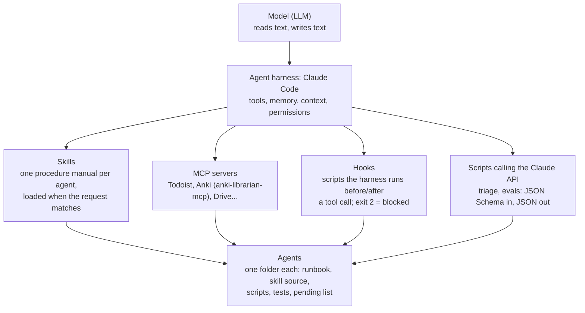
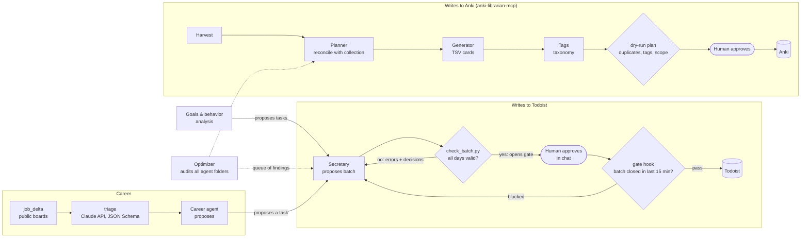

# Design notes

Details behind the README: how the pieces connect, how the model API is called, what runs in CI and the
principles the system follows.

## Architecture

### Layers

Folder is the source of truth: each agent is a folder with a `CLAUDE.md` runbook, its skill source, `src/`,
`tests/` and a single pending list. The installed skill is only a pointer to that folder.

### How agents hand work to each other

## Calling the model API

Everything above runs inside Claude Code, but two pieces call the Claude API directly from Python, through one
small client (`personal_ai_agents/llm/client.py`):

| Concern | How |
|---|---|
| Structured output | the request carries a JSON Schema (`personal_ai_agents/schemas/`); the answer is validated again with `jsonschema` |
| Business rules | an optional `check` in code; a failing answer is sent back once with the complaints, then the run stops for that item |
| Retries / timeout | exponential backoff with jitter on 429, 5xx and connection errors; 30 s per attempt |
| Cost | cheapest model (Claude Haiku 5.5), `max_tokens` 600, effort `low`, a hard call cap per run |
| Cache | every accepted answer is recorded (`data/recorded/`); an identical request is never paid twice |
| Demo mode | without a key the recordings replay the run: tests and CI need no secret |
| Observability | one JSON line per call in `logs/`; one `output/runs/<run>/trace.jsonl` per run with every stage (also for answers replayed from recordings: what they cost when recorded) |
| Secrets | `ANTHROPIC_API_KEY` from the environment or `.env` (git-ignored); never printed or logged |

Measured on 19 Oct 2026: the triage of 35 real openings made 20 calls for US$ 0.003; an eval run (12 cases +
2 controls) about US$ 0.007; the demo's two planner rounds US$ 0.0013. All are free to repeat. The planner is the
one step that runs at effort `medium` with adaptive thinking: at `low` it misread the weekday and once dropped
half of the request while still producing a valid batch, which is why the planner must now declare whether it
fulfilled the request (`request_fulfilled`), and an unfulfilled request goes to the human.

## Automation (GitHub Actions)

- **tests** (every push): the unit tests, then the eval regression gate on the recorded answers (fails if fewer
  than 11 of 12 cases pass or if the judge passes a negative control).
- **weekly job triage** (Mondays, and on demand): job-board delta + LLM triage, at most 15 calls, state kept
  between runs with the Actions cache, report uploaded as an artifact. It runs only if the `ANTHROPIC_API_KEY`
  secret exists; without it the job does nothing.

## Design principles

1. **The folder is the source of truth.** Runbook, skill, scripts and tests live together in git; anything
   installed elsewhere is a cache or a pointer.
2. **Validate before write.** A deterministic script checks the whole proposal; the write tool is physically
   blocked by a hook until the check passes. The model's confidence is not evidence.
3. **Code first, model for the fuzzy part.** What a rule can decide is decided in code (the triage discards
   senior roles with no call); the model only reads free text, and its answer is checked against the rules.
4. **Human approval for live data.** Agents read freely; every write to Todoist, Anki or a spreadsheet goes
   through an explicit "ok". Approval flags expire after 15 minutes.
5. **Every mistake becomes a check.** A new error class gets a rule in the validator and a regression case.
6. **Generator != evaluator.** The eval judge never sees the skill it is grading; negative controls keep it honest.
7. **One commit per batch**, staging only the touched paths; pushes are denied in the harness settings.
8. **Privacy by default.** Allowlist what is shown, audit what is rendered, abort on any hit.
9. **Secrets out of code.** OAuth connectors for SaaS tools; API keys from the environment (`.env.example`).

## Requirement map (agent and automation roles)

| Requirement | Where it shows up here |
|---|---|
| Multi-step agents (planner / researcher / analyst / reviewer) | `demo.py`: planner -> validator -> human -> gate -> write; card pipeline harvest -> planner -> generator -> tags; eval agent -> judge |
| LLM beyond chat (API, structured output, pipeline) | `personal_ai_agents/llm/client.py`, `personal_ai_agents/career/triage.py`, `personal_ai_agents/agent_evals/run_evals.py` |
| Tool use with schemas and validation | `personal_ai_agents/schemas/*.json` + `jsonschema`; `check_batch.py` gating MCP calls |
| Guardrails and policies | `gate_hook.py`, triage business rules, blocked sources in `job_delta.py`, the Anki write lock |
| Evals / reference cases | request cases + LLM judge + negative controls + scoreboard; reference batches; output-comparison tests |
| Logging / traceability | trace.jsonl per run + viewer; JSON log per call; generated delta and triage reports; queue with "since" dates |
| Retries, timeouts, idempotency | client backoff and timeout; delta state and per-opening verdicts (second run = 0 calls) |
| Git with README and runbook | this repo; `RUNBOOK.md`; each agent's `CLAUDE.md` is its runbook |
| Secrets out of code | `.env.example`, Actions secret, OAuth connector, `.gitignore` |
| LGPD / privacy | `public_filter.py`, fictitious examples, private agents documented by architecture only |
