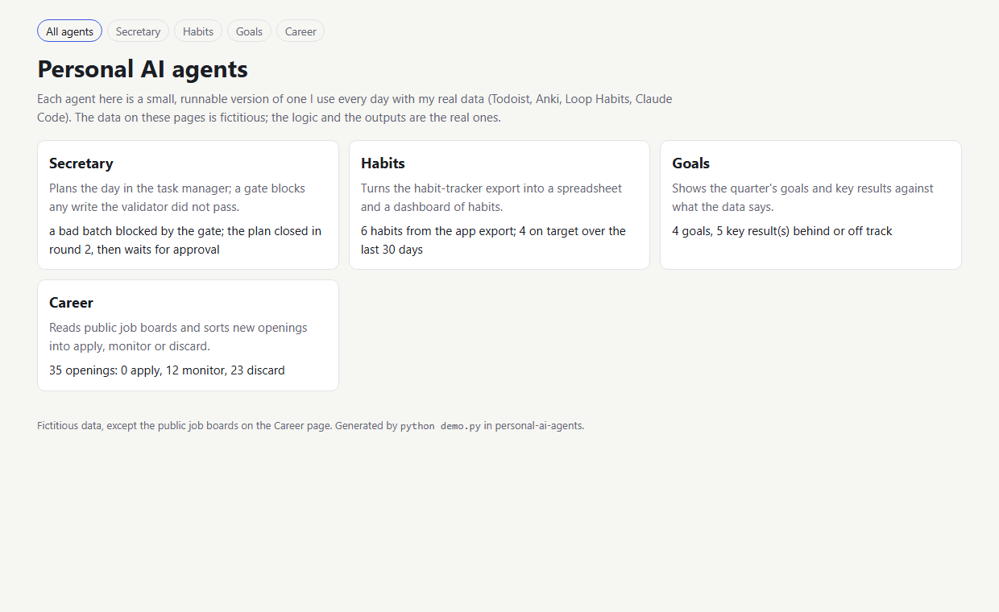
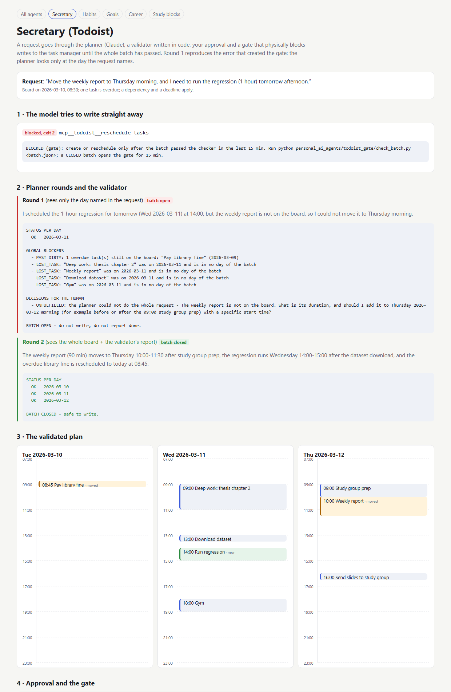
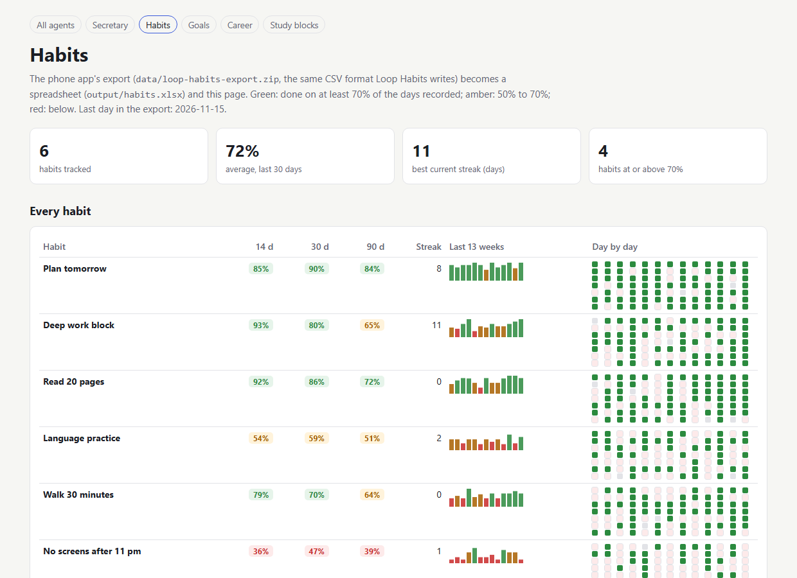
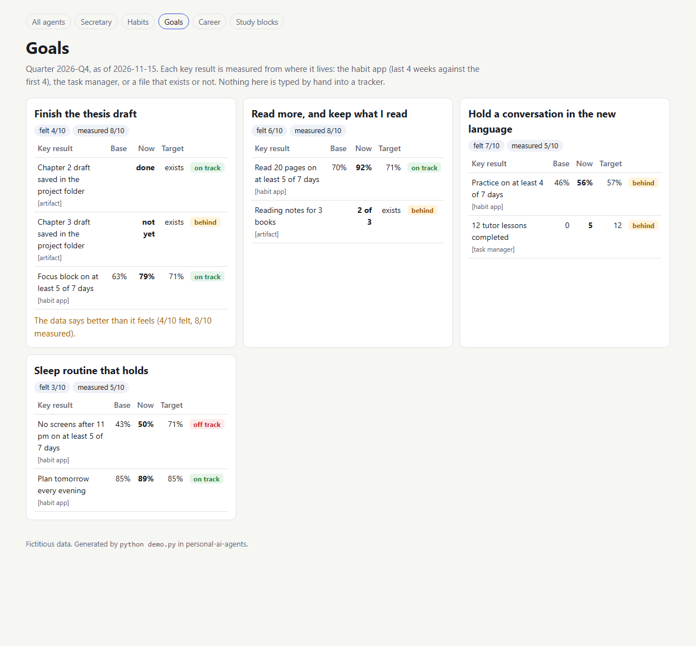
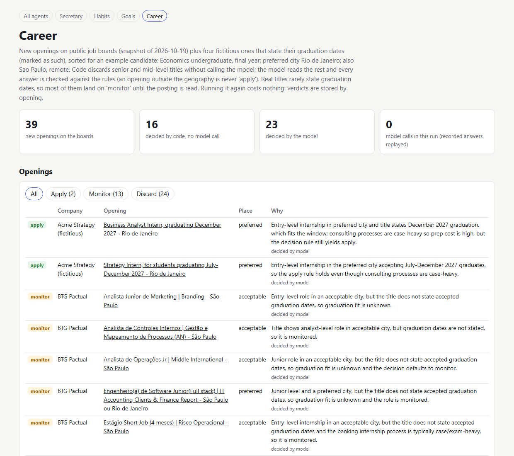

# How it works

The detail behind the README: what each demo shows, the agents and their rules, the data, the command-line
options, and how to run each agent on your own files. Operations and troubleshooting are in
[`RUNBOOK.md`](../RUNBOOK.md).

## What each demo shows

| What happens | Where to see it |
|---|---|
| The calendar agent tries to change tasks before its plan was checked and is blocked; its first plan fails the checker and is sent back with the reasons; the second passes, and only then does the write go through | `python demo.py secretary` · [screenshot](demo-secretary.png) |
| 35 real openings from public job boards sorted for an example candidate: 16 settled by simple rules with no AI call, 19 read by Claude, for about US$ 0.003; four fictitious openings that state their graduation dates show all three outcomes (apply, monitor, discard) | [`output/career.html`](../output/career.html) · [`output/triage_report.md`](../output/triage_report.md) |
| 11 of 12 test requests handled the way the career agent's rules say; the grader also rejects the two wrong answers planted to check it | [`output/evals/scoreboard.csv`](../output/evals/scoreboard.csv) · [`output/evals/last-run.md`](../output/evals/last-run.md) |
| Goals scored from the data, next to how they feel: one goal feels like 4/10 and measures 8/10 | [`output/goals.html`](../output/goals.html) |
| Flashcards meet the calendar: the review forecast finds three decks with no study block; a first plan that drops every new block at 21:00 is refused by the checker, the plan that uses the free slots passes, and the batch waits for approval | `python demo.py study` · [screenshot](demo-study.png) |

## Running the demo

Runs without an API key, replaying recorded answers. Set `ANTHROPIC_API_KEY` to call Claude live (add `--live`).
It writes one page per agent to `output/` and opens the index. `python demo.py secretary` (or `habits`, `goals`,
`career`, `study`) runs one agent; the calendar agents ask before writing, and `--yes` approves without asking.

| Option | What it does |
|---|---|
| `secretary`, `habits`, `goals`, `career`, `study` | run only these agents (default: all, plus the index page) |
| `--yes` | approve the calendar writes without asking (without it, and with no keyboard, nothing is approved) |
| `--no-open` | do not open the browser |
| `--live` | call Claude for any answer not recorded yet (needs `ANTHROPIC_API_KEY`) |
| `--input`, `--goals`, `--sources`, `--profile`, `--board`, `--request`, `--week` | your own files, below |

## The agents

Each agent is a folder of instructions and code that Claude follows inside Claude Code; the parts that can run on
their own are here, with fictitious data.

| Agent | What it does | Real app it works with |
|---|---|---|
| **Secretary** | plans and replans the day and the week; a script checks the whole plan, and a *hook* (a check Claude Code runs before every tool call) blocks any write to the calendar until the plan passed | Todoist |
| **Habits** | turns the phone app's export into a spreadsheet and a dashboard (14, 30 and 90 days) | Loop Habits |
| **Goals** | scores each key result from where it lives (habit app, task manager, a file that exists or not) and shows it next to how the goal feels | Todoist, Loop Habits |
| **Career** | reads public job boards, keeps only what changed since last week, and sorts new openings into apply, monitor or discard | public job boards, Claude API |
| **Study blocks** | turns how many flashcards fall due in each deck into study blocks on the calendar: every deck gets one block that opens it, sized by the forecast, written through the same checker and hook | Anki, Todoist |
| Librarian | turns study material into flashcards with the same safety rules; lives in its own repository, [anki-librarian-mcp](https://github.com/gcabralcavalcanti/anki-librarian-mcp) | Anki |
| Optimizer | audits the other agents' folders and keeps a list of problems that closes itself when they are fixed | git |

The rules every agent follows: read freely, write only after approval; check the whole plan in code before
writing (the model's confidence is not evidence); every past mistake becomes a check with a test; nothing private
leaves the computer. More: [`docs/design.md`](design.md), the story behind one rule in
[`docs/case-study-recurrence-gate.md`](case-study-recurrence-gate.md), and one page per agent in this folder.

| Habits | Goals | Career |
|---|---|---|
|  |  |  |

## Data

- Calendar, habits, goals and the flashcard week: **fictitious**, written for the demo ([`data/`](../data/)). The habit export is
  generated in the same format the Loop Habits app writes.
- Career: **real public job-board titles**, saved on 19 Oct 2026
  ([`data/job_board_snapshot.json`](../data/job_board_snapshot.json)), four fictitious openings marked as such
  ([`data/example_openings.json`](../data/example_openings.json)), and an example candidate profile.
- Claude's answers for the demo are stored in [`data/recorded/`](../data/recorded/) so every run can be replayed.
- The private system this comes from (600+ commits) is not here. Some files are close copies, others simplified
  versions; each file says which.

## Limits

- An excerpt: the real calendar checker has about 40 rules; the one here keeps the structure and a handful.
- The job triage reads only titles and places, so graduation dates usually come back "unknown".
- A plan can pass every check and still not be what you meant; that is why the human approval stays.
- The goals and memoir agents that work on private material are described, not included.

## Privacy & LGPD

Everything here is fictitious or public. Before anything personal leaves my computer it goes through a filter: an
allow-list of what may be shown and a scan for forbidden terms that stops publication on any hit
([`personal_ai_agents/privacy/`](../personal_ai_agents/privacy/)). No personal record, name or credential is in this
repository.

## Using it with your own data

Every agent takes your own file in place of the fictitious one. Nothing below writes anywhere except `output/`.

| Agent | What you need | Command |
|---|---|---|
| Habits | the Loop Habits app on your phone, in its settings: export as CSV (a `.zip`) or full backup (a `.db`); copy the file to the computer | `python demo.py habits --input "Loop Habits CSV.zip"` |
| Goals | the same export, plus a goals file in the format of [`data/goals.json`](../data/goals.json): each key result is a file that exists or not, a habit (its name as in the app and a target share of days) or a count you copy from the task manager | `python demo.py goals --input <export> --goals my_goals.json` |
| Career | a list of public career pages in the format of [`data/sources.csv`](../data/sources.csv) (`area;company;link`) and your criteria in the format of [`data/triage_profile.json`](../data/triage_profile.json); reading Claude's answers needs `ANTHROPIC_API_KEY` in `.env` | `python demo.py career --sources my_sources.csv --profile my_profile.json --live` |
| Secretary | a task board in the format of [`data/demo_board.json`](../data/demo_board.json), written by hand or read from Todoist (below) | `python demo.py secretary --board my_board.json --request "move the review to Thursday" --live` |
| Study blocks | a week in the format of [`data/study_week.json`](../data/study_week.json); its `forecast` can come from your Anki (below) | `python demo.py study --week my_week.json` |

**Reading Todoist.** Put a personal token (Todoist: *Settings > Integrations > Developer*) in `.env` as
`TODOIST_API_TOKEN`, then `python personal_ai_agents/todoist_gate/todoist_export.py --days 3 > my_board.json`.
The script only reads. The demo writes only to a fake board; writing to a real Todoist goes through Claude Code's
Todoist connector, and the same hook refuses every write until the checker closed the batch in the last 15 minutes
([`RUNBOOK.md`](../RUNBOOK.md) shows how to switch it on).

**Reading Anki.** Open Anki with the AnkiConnect add-on (code `2055492159`), then
`python personal_ai_agents/study/anki_forecast.py "Deck A" "Deck B" > forecast.json` and paste the list into your
week file. It sends reading actions only. Start with a test deck; the flashcard writer lives in
[anki-librarian-mcp](https://github.com/gcabralcavalcanti/anki-librarian-mcp).
